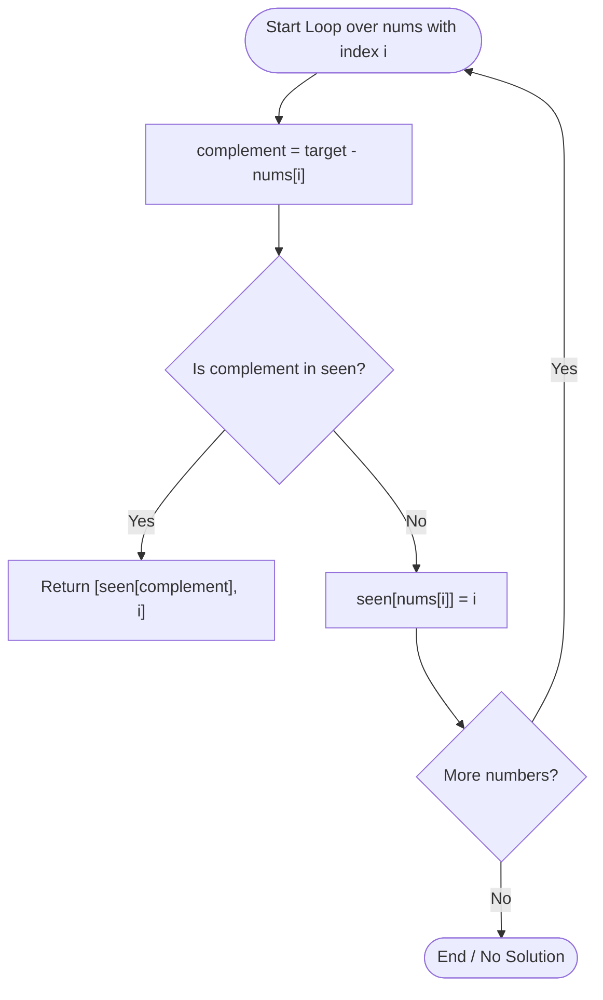

# 💡 Two Sum - Solution Deep Dive

---

## 🧠 Thought Process & Mental Model

The equation we are trying to solve is:
$$\text{num}_1 + \text{num}_2 = \text{target}$$

If we rewrite this algebraically for any current number we are looking at:
$$\text{complement} = \text{target} - \text{current\_num}$$

This simple equation shifts our mindset from **"Can I find two numbers that sum to target?"** (requires pairs) to **"For this current number, have I already encountered its missing partner?"** (requires a memory lookup).

---

## 🛠️ Approaches

### Approach 1: The Naive Brute Force ($O(N^2)$ Time, $O(1)$ Space)
Test every possible pair of numbers using two nested loops:
- Outer loop picks `i` from `0` to `n-1`.
- Inner loop picks `j` from `i+1` to `n-1`.
- If `nums[i] + nums[j] == target`, return `[i, j]`.

**Why it's suboptimal**: If an array has $10,000$ numbers, $10,000^2 = 100,000,000$ operations! In an interview, an interviewer will immediately ask: *"Can we do better than $O(N^2)$?"*

---

### Approach 2: One-Pass Hash Map ($O(N)$ Time, $O(N)$ Space) ⭐ OPTIMAL

Instead of repeatedly looping through the array to find the missing partner, we use a **Hash Map** (`dict` in Python) to remember numbers we have seen so far and their positions.

A hash map lookup in Python takes **$O(1)$ average time**.

#### Step-by-Step Algorithm:
1. Initialize an empty dictionary `seen = {}` where `key = number_value` and `value = index`.
2. Iterate through `nums` using `enumerate` (gives both `i` and `num`).
3. For each `num`, calculate `complement = target - num`.
4. Check: Is `complement in seen`?
   - **If YES**: We found our pair! Return `[seen[complement], i]`.
   - **If NO**: Store the current number in the dictionary: `seen[num] = i`.
5. Move to the next number.

---

## 📊 Step-by-Step Visual Trace

Input: `nums = [2, 7, 11, 15]`, `target = 9`

```
Iteration 0:
  Index i = 0, num = 2
  complement = target - num = 9 - 2 = 7
  Is 7 in seen? {} -> NO
  Save 2: seen[2] = 0
  Map State: { 2: 0 }

Iteration 1:
  Index i = 1, num = 7
  complement = target - num = 9 - 7 = 2
  Is 2 in seen? { 2: 0 } -> YES! (Found at index 0)
  Return [seen[2], 1] => [0, 1] 🎯 SUCCESS!
```

Mermaid Flowchart of the algorithm:



---

## ⏱️ Complexity Analysis

- **Time Complexity**: **$O(N)$**
  - We traverse the list containing $N$ elements only once.
  - Looking up whether `complement in seen` takes **$O(1)$** amortized time because of hash table indexing.
  - Overall time: $N \times O(1) = O(N)$.

- **Space Complexity**: **$O(N)$**
  - In the worst case, we might store almost all $N$ elements in the hash map before finding the match at the very end.
  - $O(N)$ extra memory is a fantastic trade-off to drop runtime from quadratic $O(N^2)$ to linear $O(N)$.

---

## 🤖 AI / Machine Learning Engineer Connection

Why does this matter for AI Engineers?
- **Feature Lookups & Embeddings**: Lookups by key in Python dictionaries or Redis in $O(1)$ time is identical to embedding table lookups in deep learning (`torch.nn.Embedding`).
- **Data Deduplication**: When preprocessing multi-gigabyte training corpora for LLM pre-training, tracking seen tokens or n-grams with hash sets/maps allows instant filtering in $O(N)$ instead of quadratic comparison.
