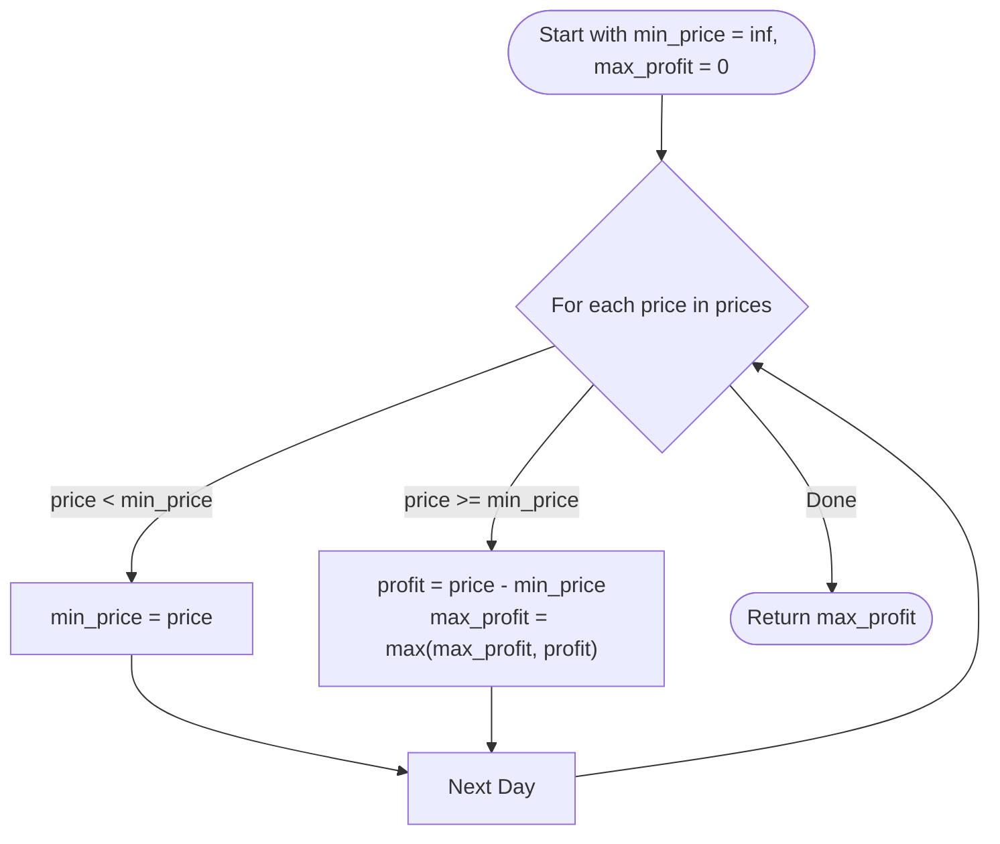

# 💡 Best Time to Buy and Sell Stock - Solution Deep Dive

---

## 🧠 Thought Process & Mental Model

How would you solve this if you were scanning prices day-by-day in real time?
As you progress through each day:
1. You keep track of the **cheapest price seen so far** (`min_price`).
2. If today's price is higher than that cheapest price, you check: *"If I had bought on that cheapest day and sold today, how much profit would I make?"* (`profit = current_price - min_price`).
3. You compare that with your **all-time best profit** (`max_profit = max(max_profit, profit)`).
4. If today's price is even cheaper than `min_price`, you update `min_price` to today's price!

This is a classic **Single-Pass Greedy / Sliding Window** pattern. We only need to walk through the array **once**.

---

## 🛠️ Approaches

### Approach 1: Brute Force ($O(N^2)$ Time, $O(1)$ Space)
Check all pairs $(i, j)$ with $i < j$:
- Buy on day $i$, sell on day $j$.
- If `prices[j] - prices[i] > max_profit`, update `max_profit`.

```python
# Naive approach
max_profit = 0
for i in range(len(prices)):
    for j in range(i + 1, len(prices)):
        profit = prices[j] - prices[i]
        max_profit = max(max_profit, profit)
```
- **Why it fails**: For $N = 10^5$, $N^2 = 10^{10}$ operations. In Python, $10^8$ operations take ~1 second, so $10^{10}$ will result in a **Time Limit Exceeded (TLE)** error.

---

### Approach 2: One-Pass Greedy Tracking ($O(N)$ Time, $O(1)$ Space) ⭐ OPTIMAL

We maintain two simple scalar variables:
1. `min_price`: Initialized to positive infinity (`float('inf')`).
2. `max_profit`: Initialized to `0`.

For each price `p` in `prices`:
- If `p < min_price`: update `min_price = p` (found a cheaper day to buy!).
- Else: check profit `p - min_price`. If greater than `max_profit`, update `max_profit`.

---

## 📊 Step-by-Step Visual Trace

Input: `prices = [7, 1, 5, 3, 6, 4]`

| Day | Price | `min_price` before | Action | `min_price` after | Potential Profit | `max_profit` |
|:---:|:---:|:---:|:---:|:---:|:---:|:---:|
| 0 | 7 | $\infty$ | $7 < \infty \rightarrow$ Update `min_price` | 7 | 0 | 0 |
| 1 | 1 | 7 | $1 < 7 \rightarrow$ Update `min_price` | 1 | 0 | 0 |
| 2 | 5 | 1 | $5 > 1 \rightarrow$ Check profit: $5 - 1 = 4$ | 1 | 4 | **4** |
| 3 | 3 | 1 | $3 > 1 \rightarrow$ Check profit: $3 - 1 = 2$ | 1 | 2 | 4 |
| 4 | 6 | 1 | $6 > 1 \rightarrow$ Check profit: $6 - 1 = 5$ | 1 | 5 | **5** 🎯 |
| 5 | 4 | 1 | $4 > 1 \rightarrow$ Check profit: $4 - 1 = 3$ | 1 | 3 | 5 |

**Final Answer**: `5`



---

## ⏱️ Complexity Analysis

- **Time Complexity**: **$O(N)$**
  - We iterate through the array of length $N$ exactly once. Inside the loop, finding the minimum and maximum takes $O(1)$ constant time.
- **Space Complexity**: **$O(1)$**
  - We only use two variables (`min_price` and `max_profit`). No extra data structures or memory arrays are created!

---

## 🤖 AI / Machine Learning Engineer Connection

- **Online Stream Processing**: In real-time ML systems (e.g., fraud detection or algorithmic trading feature pipelines), data arrives as an infinite stream of events. You cannot store the entire history or run $O(N^2)$ computations. Keeping running minimums/maximums in $O(1)$ space and $O(1)$ per-item time is the foundation of stream statistics and feature extraction.
- **Model Loss Tracking**: During neural network training, tracking the `best_validation_loss` to implement **Early Stopping** uses this exact same single-pass tracking logic.
