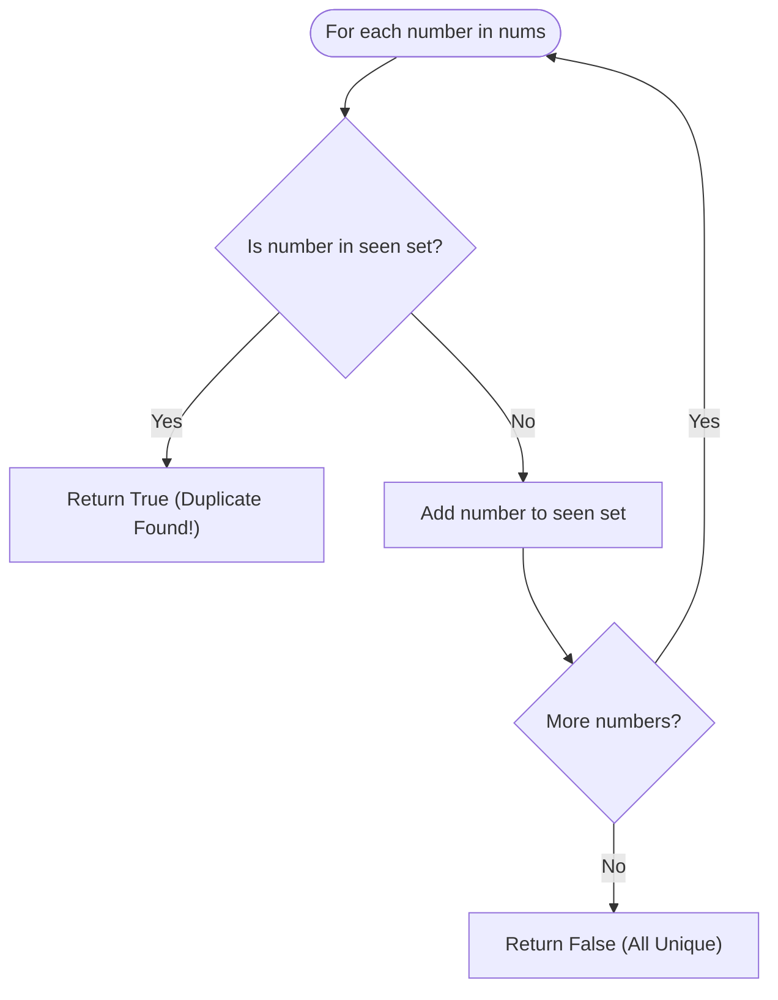

# 💡 Contains Duplicate - Solution Deep Dive

---

## 🧠 Thought Process & Mental Model

There are three classic ways to approach this problem, each teaching a fundamental DSA pattern:
1. **Brute Force**: Compare every pair $(i, j)$. Takes $O(N^2)$ time.
2. **Sorting**: Sort the array in ascending order. If any duplicates exist, they will now be sitting directly next to each other! Takes $O(N \log N)$ time and $O(1)$ extra space.
3. **Hash Set**: Keep a set of seen numbers. Since sets guarantee uniqueness and $O(1)$ lookups, we can detect duplicates in a single pass. Takes $O(N)$ time and $O(N)$ space.

---

## 🛠️ Approaches

### Approach 1: Sorting ($O(N \log N)$ Time, $O(1)$ Space)
If we sort `[1, 5, 2, 1, 4]`, it becomes `[1, 1, 2, 4, 5]`.
We then iterate once and check if `nums[i] == nums[i - 1]`.
- **Pros**: Uses no extra memory ($O(1)$ auxiliary space if in-place).
- **Cons**: Slower than $O(N)$, modifies the array order.

---

### Approach 2: Hash Set Lookup ($O(N)$ Time, $O(N)$ Space) ⭐ OPTIMAL

A `set` in Python is backed by a hash table.
- Checking `num in seen` takes **$O(1)$** average time.
- Adding `seen.add(num)` takes **$O(1)$** average time.

#### Algorithm:
```python
seen = set()
for num in nums:
    if num in seen:
        return True
    seen.add(num)
return False
```

#### Approach 2B: The Pythonic One-Liner (Length Comparison)
In Python, converting a list to a set automatically strips all duplicates:
```python
return len(nums) != len(set(nums))
```
*Note for interviews*: While interviewers love seeing you know `len(nums) != len(set(nums))`, they will also want you to explain the early-exit loop version because `set(nums)` always iterates through the entire list even if the very first two numbers are duplicates!

---

## 📊 Comparison Table of Approaches

| Approach | Time Complexity | Space Complexity | Early Exit? | Modifies Array? |
| :--- | :---: | :---: | :---: | :---: |
| **Brute Force** | $O(N^2)$ | $O(1)$ | Yes | No |
| **Sorting** | $O(N \log N)$ | $O(1)$ or $O(N)$ | Yes | Yes |
| **Hash Set Loop** | **$O(N)$** | **$O(N)$** | **Yes** | No |
| **`len(set(nums))`** | **$O(N)$** | **$O(N)$** | No | No |



---

## ⏱️ Complexity Analysis (Hash Set)

- **Time Complexity**: **$O(N)$**
  - In the worst case (all numbers distinct), we visit all $N$ numbers and perform an $O(1)$ set lookup and insert for each.
  - If a duplicate occurs early, the algorithm exits in $O(1)$ to $O(K)$ steps!
- **Space Complexity**: **$O(N)$**
  - In the worst case, the hash set will store $N$ distinct integers.

---

## 🤖 AI / Machine Learning Engineer Connection

- **Training Data Cleaning**: In NLP and Computer Vision pipelines, duplicate or near-duplicate examples cause models to overfit and waste compute. Exact deduplication is performed using hash sets of sample IDs or SHA-256 hashes of text/images.
- **Vocabulary Creation**: Building the tokenizer vocabulary for an LLM (e.g. BPE or WordPiece) begins by collecting the set of unique characters/tokens present in the raw corpus.
