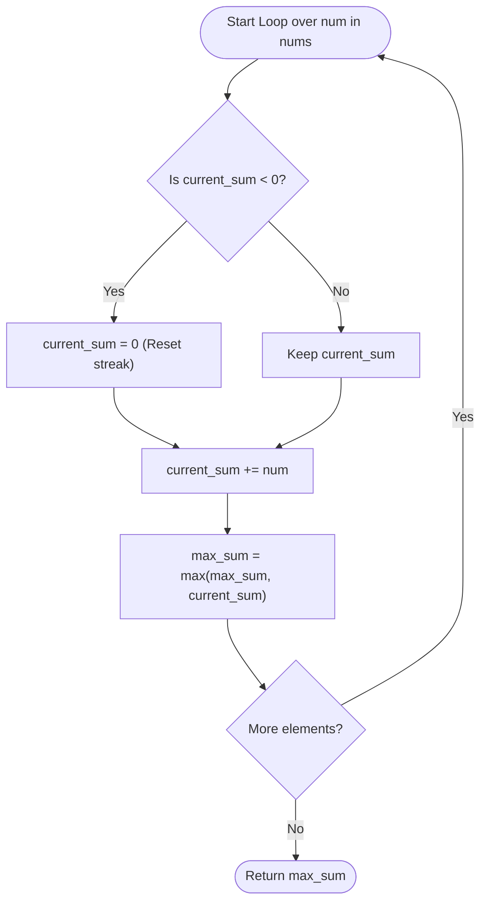

# 💡 Maximum Subarray - Solution Deep Dive (Kadane's Algorithm)

---

## 🧠 Thought Process & Mental Model

Let's think step-by-step:
Suppose we are at index `i` looking at `nums[i]`. We have two choices:
1. **Extend the existing subarray**: Add `nums[i]` to whatever best subarray sum ended at `i - 1`.
2. **Start fresh**: Throw away the past subarray and start a new subarray beginning right at `nums[i]`.

When would we choose to throw away the past?
Only when the sum from the past is **negative**!
If `current_sum < 0`, adding it to `nums[i]` makes the total *smaller* than `nums[i]` by itself.

Therefore:
$$\text{current\_sum} = \max(\text{nums}[i], \text{current\_sum} + \text{nums}[i])$$

This is known world-over as **Kadane's Algorithm** (a classic Dynamic Programming / Greedy technique).

---

## 🛠️ Approaches

### Approach 1: Brute Force ($O(N^2)$ Time, $O(1)$ Space)
Evaluate every possible subarray starting at index `i` and ending at index `j`:
```python
max_sum = float('-inf')
for i in range(len(nums)):
    current_sum = 0
    for j in range(i, len(nums)):
        current_sum += nums[j]
        max_sum = max(max_sum, current_sum)
```
- For $N = 10^5$, $N^2 = 10^{10}$ operations $\rightarrow$ **Time Limit Exceeded (TLE)**.

---

### Approach 2: Kadane's Algorithm ($O(N)$ Time, $O(1)$ Space) ⭐ OPTIMAL

#### Algorithm:
1. Initialize:
   - `max_sum = nums[0]` (best answer seen so far)
   - `current_sum = 0` (running sum of active subarray)
2. Iterate through each `num` in `nums`:
   - If `current_sum < 0`: reset `current_sum = 0` (discard harmful debt!).
   - Add `num` to `current_sum`.
   - Update `max_sum = max(max_sum, current_sum)`.
3. Return `max_sum`.

---

## 📊 Step-by-Step Visual Trace

Input: `nums = [-2, 1, -3, 4, -1, 2, 1, -5, 4]`

| Step | `num` | Reset if `current_sum < 0`? | `current_sum += num` | `max_sum` | Subarray State |
|:---:|:---:|:---:|:---:|:---:|:---:|
| 0 | -2 | 0 | -2 | **-2** | `[-2]` |
| 1 | 1 | Yes (was -2 $\rightarrow$ 0) | $0 + 1 = 1$ | **1** | `[1]` (started new streak) |
| 2 | -3 | No | $1 + (-3) = -2$ | 1 | `[1, -3]` |
| 3 | 4 | Yes (was -2 $\rightarrow$ 0) | $0 + 4 = 4$ | **4** | `[4]` (started new streak) |
| 4 | -1 | No | $4 + (-1) = 3$ | 4 | `[4, -1]` |
| 5 | 2 | No | $3 + 2 = 5$ | **5** | `[4, -1, 2]` |
| 6 | 1 | No | $5 + 1 = 6$ | **6** 🎯 | `[4, -1, 2, 1]` |
| 7 | -5 | No | $6 + (-5) = 1$ | 6 | `[4, -1, 2, 1, -5]` |
| 8 | 4 | No | $1 + 4 = 5$ | 6 | `[4, -1, 2, 1, -5, 4]` |

**Result**: `6` from subarray `[4, -1, 2, 1]`.



---

## ⏱️ Complexity Analysis

- **Time Complexity**: **$O(N)$**
  - A single pass over the array of size $N$. At each element, we do $O(1)$ arithmetic operations.
- **Space Complexity**: **$O(1)$**
  - Only two scalar integers are used (`current_sum` and `max_sum`).

---

## 🤖 AI / Machine Learning Engineer Connection

- **Genomic Sequence & Audio Signal Peak Detection**: Finding regions of highest continuous activation or energy bursts (e.g. voice activity detection, VAD) is mathematically identical to maximum subarray over continuous time-series energy.
- **1D Feature Map Pooling**: Finding the most salient activation segment in 1D convolutional neural networks (1D-CNNs) on sequence data.
