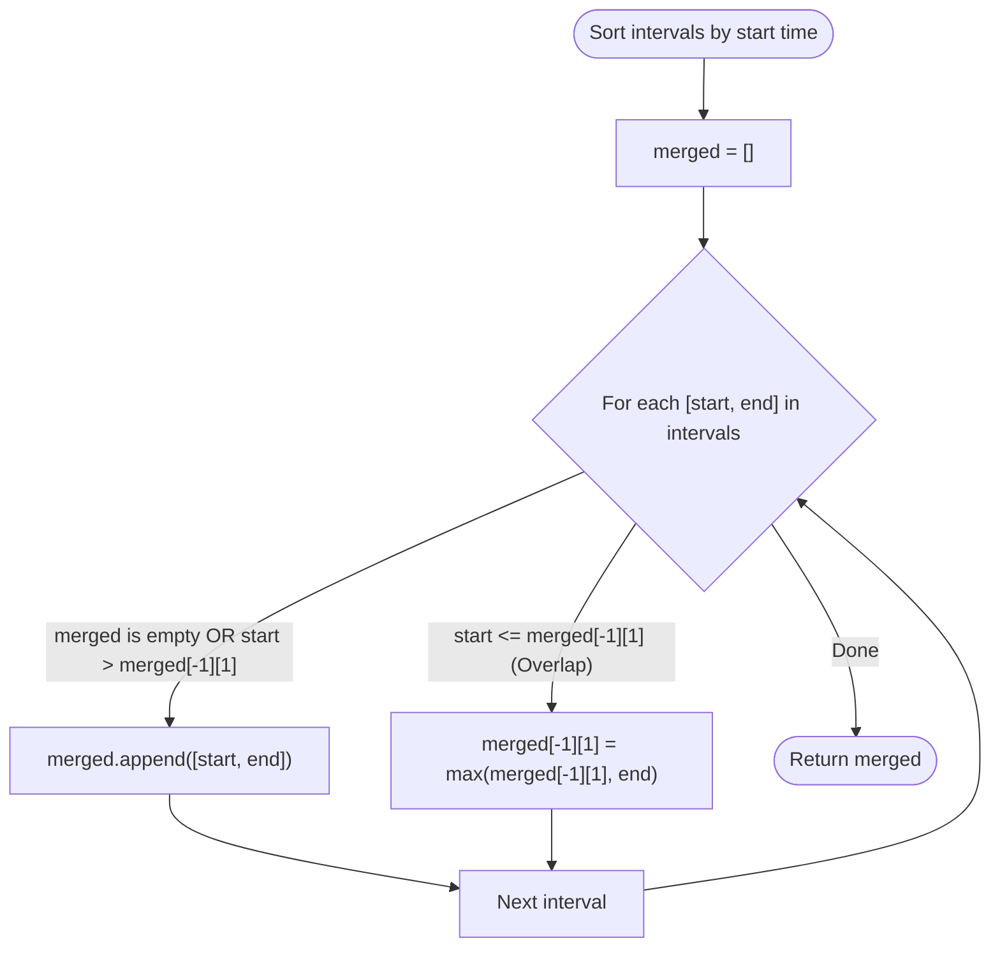

# 💡 Merge Intervals - Solution Deep Dive

---

## 🧠 Thought Process & Mental Model

Why is this problem hard if intervals are unsorted?
Because an interval at the end of the array could overlap with an interval at the beginning! You would have to constantly rescan the entire array over and over again ($O(N^2)$).

**The Aha! Moment**:
If we sort all intervals by their **start time** (`start_i`):
Every subsequent interval will start **at or after** the previous interval's start time!
This gives us a wonderful invariant:
For any new interval `[start, end]`:
- It can **ONLY** overlap with the interval directly before it (the latest merged interval in our output list).
- It can **NEVER** reach backwards in time to merge with an earlier interval that finished before this start time!

---

## 🛠️ Optimal Algorithm ($O(N \log N)$ Time, $O(N)$ Space)

1. **Sort**: Sort `intervals` by `start` time:
   ```python
   intervals.sort(key=lambda x: x[0])
   ```
2. **Initialize Output**:
   Create an empty list `merged = []`.
3. **Iterate**:
   For each interval `[start, end]` in `intervals`:
   - If `merged` is empty, OR `start > merged[-1][1]` (current interval starts *after* the previous merged interval ends):
     - **No overlap!** Append `[start, end]` directly to `merged`.
   - Else (Overlap occurs: `start <= merged[-1][1]`):
     - **Merge them!** Extend the end of the previous interval:
       `merged[-1][1] = max(merged[-1][1], end)`
4. **Return `merged`**.

---

## 📊 Step-by-Step Visual Trace

Input: `[[1, 3], [2, 6], [8, 10], [15, 18]]` (Already sorted by start time)

```
Initialize: merged = []

1. Process [1, 3]:
   merged is empty.
   Add [1, 3] -> merged = [[1, 3]]

2. Process [2, 6]:
   Does [2, 6] start <= last end (3)?
   2 <= 3 -> YES, OVERLAP!
   Update last end: max(3, 6) = 6
   merged = [[1, 6]]

3. Process [8, 10]:
   Does [8, 10] start <= last end (6)?
   8 <= 6 -> NO, NO OVERLAP!
   Append [8, 10] -> merged = [[1, 6], [8, 10]]

4. Process [15, 18]:
   Does [15, 18] start <= last end (10)?
   15 <= 10 -> NO, NO OVERLAP!
   Append [15, 18] -> merged = [[1, 6], [8, 10], [15, 18]]

Final Output: [[1, 6], [8, 10], [15, 18]] 🎯
```



---

## ⏱️ Complexity Analysis

- **Time Complexity**: **$O(N \log N)$**
  - Sorting $N$ intervals takes $O(N \log N)$ time using Python's Timsort.
  - The subsequent single pass through the sorted array takes $O(N)$ linear time.
  - Overall time: $O(N \log N) + O(N) = O(N \log N)$.
- **Space Complexity**: **$O(N)$**
  - Storing the output list `merged` takes up to $O(N)$ space (if no intervals overlap).
  - Python's `.sort()` uses $O(N)$ space internally for sorting.

---

## 🤖 AI / Machine Learning Engineer Connection

- **Audio & Video Timeline Chunking**: In multimodal models (like Whisper for speech transcription or video LLMs), timestamped segments (e.g., subtitles, speaker turns) frequently have minor overlaps. Merging overlapping bounding intervals is a standard pre-processing step before tokenization.
- **Bounding Box Merging (NMS - Non-Maximum Suppression)**: In object detection (YOLO, Faster R-CNN), overlapping 1D intervals along axes are used to compute Intersection over Union (IoU) for merging duplicate candidate boxes.
