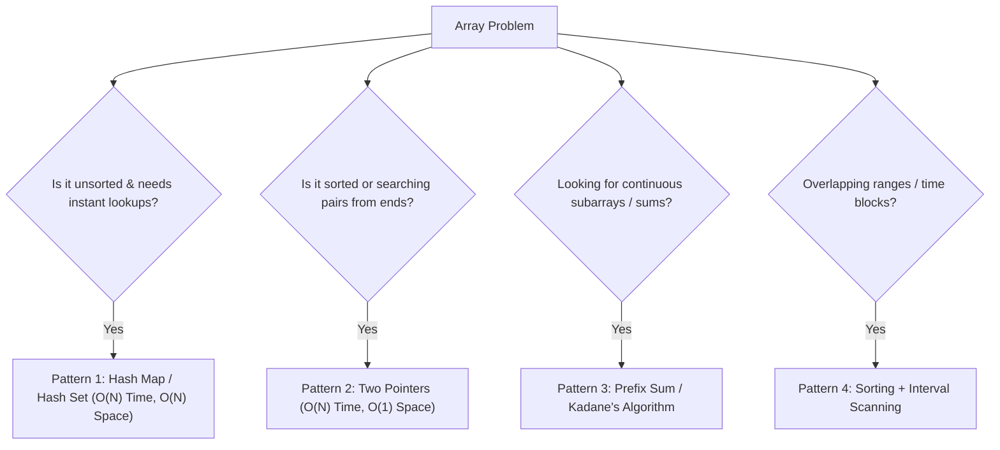

# 📦 Topic: Arrays (Python DSA from Scratch)

> **Welcome to Data Structures & Algorithms!**
> If you have never studied computer science or data structures before, don't worry. This guide begins at ground zero and explains every concept using intuition, diagrams, and real-world analogies.

---

## 🌟 1. Real-Life Analogy: What is an Array?

Imagine a row of **lockers in a school hallway** or **numbered parking spots** in a garage:

```
Index:       [0]          [1]          [2]          [3]          [4]
Memory:   0x1000       0x1004       0x1008       0x100C       0x1010
        +------------+------------+------------+------------+------------+
Value:  |  Locker A  |  Locker B  |  Locker C  |  Locker D  |  Locker E  |
        +------------+------------+------------+------------+------------+
```

1. **Contiguous (Side-by-Side) Order**: All lockers are lined up in physical order without gaps.
2. **Instant Access by Number (Index)**: If someone asks you to open locker #3, you don't need to walk from locker #0 checking one by one. You walk directly to spot #3 in **$O(1)$ constant time**.
3. **0-Indexed**: In computer science, we count starting from `0`. So the first spot is `array[0]`.

---

## 🤖 2. Why Arrays Matter to AI & Machine Learning Engineers

As an AI engineer, arrays are the bedrock of everything you will build:
- **Tensors in PyTorch & TensorFlow**: A 1D tensor is simply a contiguous array in memory. A 2D/3D tensor is just a flattened contiguous 1D array navigated by "strides".
- **GPU Acceleration (CUDA)**: GPUs achieve insane speedups (Teraflops) because threads read contiguous memory blocks together (known as *memory coalescing*). Non-contiguous data destroys GPU performance!
- **Feature Vectors & Embeddings**: When you generate a sentence embedding with an LLM (e.g. OpenAI `text-embedding-3-small`), the output is a 1536-dimensional array of floating-point numbers.
- **Batching**: Feeding batches of inputs to a neural network is organizing samples in a 2D/3D array.

---

## ⚙️ 3. How Arrays Work in Python: `list`

In low-level languages like C or Rust, an array has a fixed size.
In Python, standard arrays are implemented as **`list`**, which is a **Dynamic Array**:
- You don't need to specify the size upfront.
- When it fills up, Python automatically allocates a larger block in memory (usually ~1.125x to 1.5x larger) and copies the elements over.
- Because resizing happens infrequently, appending to a list is **Amortized $O(1)$ time**.

### Time Complexity Cheat Sheet

| Operation | Syntax | Time Complexity | Why? |
| :--- | :--- | :--- | :--- |
| **Access by index** | `arr[i]` | **$O(1)$** | Memory address = `base_address + i * element_size` |
| **Append at end** | `arr.append(x)` | **$O(1)$** | Added directly to the allocated reserved capacity |
| **Pop from end** | `arr.pop()` | **$O(1)$** | Simply shrink the length counter |
| **Insert at index** | `arr.insert(i, x)`| **$O(N)$** | All elements after index `i` must shift right by 1 |
| **Delete at index** | `arr.pop(i)` | **$O(N)$** | All elements after index `i` must shift left by 1 |
| **Search value** | `x in arr` | **$O(N)$** | Must inspect each element from left to right |
| **Slice array** | `arr[a:b]` | **$O(K)$** | Copies $K = b - a$ elements to a new list |

---

## 🎯 4. Core Patterns for Google, Meta & Startup Interviews

When an interviewer at Google or Meta asks an Array problem, they are testing if you know how to avoid the naive brute-force approach ($O(N^2)$). Here are the 4 fundamental patterns:



1. **The Hash Map / Complement Technique**: Trade a little memory ($O(N)$ space) to turn slow $O(N^2)$ searches into lightning-fast $O(N)$ lookups (e.g. *Two Sum*).
2. **Prefix & Suffix Running Accumulations**: Compute running sums or products from left-to-right and right-to-left to answer range queries in $O(1)$ (e.g. *Product of Array Except Self*).
3. **Kadane's Algorithm (Greedy Subarray Accumulation)**: Keep a running sum, and reset it if it drops below zero (e.g. *Maximum Subarray*).
4. **Interval Sorting**: Sort by start time to detect overlaps easily (e.g. *Merge Intervals*).

---

## 📚 Curated Problem Roadmap in this Directory

| # | Folder | Problem Name | Difficulty | Top Companies | Core Pattern |
| :---: | :--- | :--- | :---: | :--- | :--- |
| 1 | [`01_Two_Sum`](./01_Two_Sum/) | Two Sum | Easy | Google, Meta, OpenAI | Hash Map (Complement) |
| 2 | [`02_Best_Time_to_Buy_and_Sell_Stock`](./02_Best_Time_to_Buy_and_Sell_Stock/) | Best Time to Buy & Sell Stock | Easy | Google, Meta, Amazon | Single Pass Greedy |
| 3 | [`03_Contains_Duplicate`](./03_Contains_Duplicate/) | Contains Duplicate | Easy | Meta, Apple, Startups | Hash Set Lookup |
| 4 | [`04_Product_of_Array_Except_Self`](./04_Product_of_Array_Except_Self/) | Product of Array Except Self | Medium | Google, Meta, Microsoft | Prefix & Suffix Products |
| 5 | [`05_Maximum_Subarray`](./05_Maximum_Subarray/) | Maximum Subarray | Medium | Google, Meta, ByteDance | Kadane's Algorithm |
| 6 | [`06_Merge_Intervals`](./06_Merge_Intervals/) | Merge Intervals | Medium | Meta (#1 most asked), Google | Sorting + Greedy Overlap |

---
Navigate into each folder to start with `problem.md`, review `solution.md`, and run `solution.py`!
